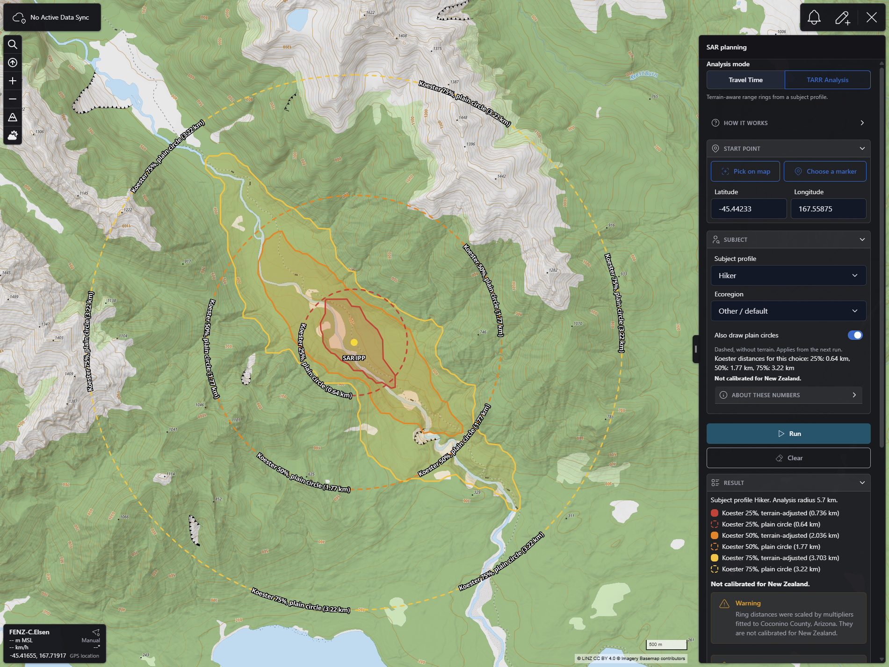

# SAR planning
CloudTAK plugin for search and rescue planning in New Zealand. Pick an Initial Planning Point (IPP), then choose one of two analysis modes. **Travel Time** draws nested contours that show how far a person could travel in each time band over New Zealand terrain, land cover, trails, roads and power-line corridors. **TARR Analysis** draws Terrain-Aware Range Rings from a Lost Person Behavior subject profile. The results become ordinary CloudTAK map features that you can select, edit, add to a Data Sync or put in a data package, and you can save them as a KMZ in your CloudTAK Files.

## What it does
* A **SAR planning** entry in the right-side menu opens a pane in the side menu, the same way the Rubber Sheet plugin does. On a phone the host shows it as a full-screen menu. The features stay on the map when the pane closes.
* **Less text, more boxes.** Explanations sit in collapsible boxes, the same host header the Rubber Sheet plugin uses for "How it works". They start closed, remember if you open them while the plugin is on, and are: **How it works** (under the mode selector, for the selected mode), **About these numbers** (TARR settings), **Details and data sources** (result) and **About saving and sharing**. Warnings, errors, the engine's disclaimer and the line "Not calibrated for New Zealand." (TARR) stay in view.
* **Look and feel.** The pane follows the CloudTAK UI and the Rubber Sheet plugin: the settings are collapsible sections with an icon (**Start point**, **Travel settings** or **Subject**, **Result**, **Save and share**; open by default, closed ones are skipped by the keyboard), buttons are the host `TablerButton` with a 20 px line icon (the main action is a full-width primary button, **Run** and **Save to Files**), the mode is a pill group, errors, warnings and results of the share actions are the host inline alerts (red, yellow, blue or green with a title), and waiting shows the host loading spinner. Text fields look like the host `TablerInput` (a small local copy, `lib/FieldInput.vue`, because `TablerInput` cannot take an `id` for its label, `inputmode` or `aria-describedby`; keep it in step with the host if the input style changes).
* **Mode.** A pill group chooses **Travel Time** or **TARR Analysis**, with a one-line description of the selected mode under it. The **How it works** box explains the selected mode, written for New Zealand data (LCDB land cover, OpenStreetMap trails, roads and waterways). TARR is greyed out with the text "Not available on this server" when the relay does not list it.
* **Start point.** Choose one of three ways: **Pick on map** (the cursor becomes a crosshair, a banner says "Tap the map to set the start point", one click sets it, Cancel or Escape stops), **Choose a marker** (a filterable list of the point markers on your map, first 100 by name), or type the latitude and longitude. The start point is previewed as a dot as soon as it is valid. On a phone the pane closes while you pick and opens again after the click.
* **Travel Time settings.**
  * **Speed** in km/h (default 2.5) with four presets in a 2 by 2 grid, the name in bold on top and the speed under it: Impaired 0.8 km/h, Slow 1.6 km/h, Moderate 3.2 km/h and Fit hiker 5.0 km/h (0.5, 1, 2 and 3.1 mph). There is no mph toggle. The hint says the speed is the assumed speed on flat, unobstructed ground and that the model adjusts for slope, land cover and trails.
  * **Time bands** as pills with the hours in bold (default 1, 2, 4 and 8 h). Add a band with the field and **Add band**, or with the quick-add buttons **Add 6 h**, **Add 10 h** and **Add 12 h**. Remove one with the red x on its chip. One to eight bands, each 0.25 to 24 h. Duplicates collapse and the chips stay in time order.
  * **Radius** in km (optional, default 10). Larger radii take longer. In cities, large radii are slow.
* **TARR settings.** Choose a **Subject profile** (28 profiles from the Koester tables). **Ecoregion** and **Terrain** selects appear when the profile has rows for them; "Other / default" uses the profile's general row. The pane shows the Koester 25%, 50% and 75% distances for the choice; the source and the calibration notices are in the **About these numbers** box. The checkbox **Also draw plain circles** (on by default, stored in the browser) switches the dashed plain circles on or off. It applies from the next run: the circles are left out of the map features, the result list and the KMZ, so all three agree. When a terrain ring is missing and its plain circle is hidden, the result lists a note. There is no radius or speed: the engine works out the analysis area.
* **Run** is disabled until the start point and the mode's inputs are set (a speed for Travel Time, a profile for TARR), and a hint says what is missing. While it runs the inputs are disabled and the pane shows the elapsed seconds and **Cancel**. A calculation can take up to a minute, especially the first one after a quiet period. A response that arrives after Cancel is ignored.
* **Result.** The pane lists each band or ring with a colour swatch and its name, the warnings (prefixed **Warning:** or **Note:**) and the engine's disclaimer. The multiplier and distances used, the calibration notices, the data attribution and the date of the roads and trails data are in the **Details and data sources** box. The map fits the result, leaving room for the open pane.
* **Clear** removes the features, the preview dot and the start point. Mode, speed, bands, radius and the profile choice are kept; they are stored in the browser (`taknz-sar:v1`). The start point is never stored.

## Reading the contours
### Travel Time
The contours are travel time: they show how far a person walking at the chosen speed could get in each time band, given the terrain, land cover, trails, roads and power-line corridors around the start point. They do not say where a person is. A smaller contour is not a better place to search.
* The method comes from the WiSAR project and has not been calibrated for New Zealand. The engine sends a disclaimer with every result and the pane shows it word for word next to the result.
* The contours are the largest contiguous area reached in each band. A band can have no contour; the pane then lists a note.
* Colour is not the only signal: every band is also written out as text, in the list and in the feature name.
* The bands use the plugin's own warm colours, smallest band first: red, orange, yellow, purple, pink, brown, white and black (the engine's cyan, green and yellow ramp is ignored because it disappears on a map with a lot of green, blue and grey). The first three are the colours of the TARR rings. A band's colour depends on its rank, so adding a band shifts the colours of the larger ones.

### TARR Analysis
A Terrain-Aware Range Ring (TARR) starts from a Lost Person Behavior distance for the subject profile (Koester, 2008, via Ferguson, 2013). It bends the ring around terrain, land cover and trails, so it stretches along easy ground and pulls in against steep or dense ground. This is a distance-based mode, not an incident statistics mode.
* **The numbers are not New Zealand numbers.** The distances come from United States search records. Before the terrain model runs, the engine scales them by a multiplier fitted to search records from Coconino County, Arizona (for example 1.15 for Hikers, 1.40 for a profile without its own value). Neither the distances nor the multipliers are calibrated for New Zealand. The ring percentages are not the chance of finding someone in New Zealand.
* The pane and every feature say so: the notice before the run, the multiplier used and its region in the result, and the remarks of each ring.
* **Each terrain ring has a plain circle next to it, unless you switch that off** (checkbox **Also draw plain circles**). The solid, filled ring is terrain-adjusted. The dashed circle with no fill is the plain Koester distance, without terrain and without multiplier, so you can see how far the terrain moved the ring.
* Rings are named by source, percentage, kind and distance, for example `Koester 50%, terrain-adjusted (2.036 km)` and `Koester 50%, plain circle (1.77 km)`. The distance of a terrain ring is the calibrated one that was used.
* A terrain ring can be missing (too small to leave the start cell, or blocked by water). The plain circle is still drawn, unless plain circles are switched off, and the pane lists a note.
* The analysis radius is the calibrated 75% distance plus 2 km, at most 30 km. The pane tells you when a ring is clipped.
* The multiplier set can be changed by the operator of the engine without a code change; the result always reports the set that was used.

## Limits
| Input | Limit |
|---|---|
| Latitude | -48 to -33.5 |
| Longitude | 165.5 to 179.5 |
| Start point | On land. A point in the sea or a lake is refused |
| Travel Time: speed | 0.1 to 10 km/h |
| Travel Time: time bands | 1 to 8, each 0.25 to 24 h |
| Travel Time: radius | Optional, 1 to 30 km. Default 10 |
| TARR: subject profile | One of the 28 Koester profiles |
| TARR: ecoregion, terrain | Only the values the table has for the profile (Temperate, Dry, Urban; Mountainous, Flat) |
| TARR: analysis radius | The calibrated 75% distance plus 2 km, clipped at 30 km. Not an input |
| Request size | At most 8 KB |

For Travel Time the engine uses the larger of the radius you enter and the speed times the longest band plus 2 km, clipped at 30 km, and tells you with a warning when it clips. The pane shows the effective radius from the response.

Timing guide: a bush area with a 10 km radius usually takes a few seconds. Large city areas with a large radius take much longer, up to most of a minute. The first request after a quiet period is slower. TARR takes about as long as Travel Time. The relay waits up to 70 seconds for the engine.

### Dense areas
In dense city areas the engine can refuse a calculation instead of running until it times out. The pane then shows the engine's message word for word.
* **Travel Time.** Depending on what the engine suggests, the pane also offers **Try {n} km**, when the engine suggests a smaller radius (it fills the radius field), and **Set longest band to {h} h**, when the engine suggests a shorter longest band. That button makes the value the longest band: the largest chip becomes that value and any chip above it is removed. If the engine suggested a radius as well, it sets both. The buttons only edit the inputs. Nothing is sent until you press **Run**. The plugin never makes up a suggestion: a number that is not finite, or outside the plugin's own limits (radius 1 to 30 km, band 0.25 to 24 h), is ignored and never rounded into range.
* **TARR.** There is no radius or band to change, so there are no buttons. The message tells you to move the start point or choose a profile with a shorter search distance.
* Other refusals, such as a start point in the sea, show their message and no button.

## Map features and exports
A result is added to the map as CloudTAK features, filed under the folder `/SAR/`, expiring after 24 hours:
* **A named outline per band or ring** (CoT type `u-d-f`, a drawn shape), with the band or ring colour and remarks that give the parameters (speed and bands, or subject profile, Koester distance, multiplier and calibrated distance), the start point, the run time in UTC, the reach or not-calibrated statement and the engine's disclaimer. Travel Time features are named `SAR 2 h`; TARR features as described above.
* **An unnamed filled area for each band and each terrain-adjusted ring** (same colour, 15 % fill, no visible line, a blank name, remarks that point to the outline). The plain TARR circles are dashed, have no fill and are a single feature. Why two features: CloudTAK writes the label of a filled polygon inside the area, where nested rings pile their labels on one spot, and the label of an unfilled polygon along its outline. So the outline is unfilled and carries the name, and the fill is a second, unnamed feature. The id of an area is the id of its outline plus `-fill`, which is how the plugin finds the pair again (in Data Sync copies too).
* The pair is two items in the CloudTAK feature list: selecting the line selects the named outline, selecting inside the area selects the unnamed fill, and editing one does not change the other. **Run** again and **Clear** replace and remove both. Add to Data Sync and Create data package carry both, so the counts double. The KMZ folds each area into its outline (one named, filled Placemark per ring, taking the fill colour and opacity of the area as it is now), so Google Earth and QGIS see one ring.
* **The start point as a point** (CoT type `u-d-p`, a plain marker, yellow) with the callsign `SAR IPP` and remarks that give the mode, the speed and bands or the subject profile, and the time of the run.
* They are real features: select them, edit them, change their style or delete them like any other. While no result exists the start point is only a dot on the map; once a result exists the `SAR IPP` feature replaces the dot, so there are no duplicates. **Run** again replaces the previous result's features. **Clear** removes the features and the dot. Disabling the plugin leaves the features on the map.
* A MultiPolygon contour becomes one feature per part (`SAR 2 h`, `SAR 2 h (2)` and so on).

After a result the pane offers three actions. They use the features as they are on the map, so edits are included.
* **Save to Files** builds a KMZ in the browser (one `doc.kml` with a style per colour, one Placemark per feature with inner rings, and the start point as a Point; the document description carries the parameters, the disclaimer and the attribution) and uploads it the way the Files menu upload does (`PUT /api/import`). CloudTAK converts it to a file in **Files**, named `SAR <mode> <YYYYMMDD-HHMM>Z.kmz`, so repeated runs do not collide. The pane shows the progress, then **Saved ... to Files**, and an **Open Files** button. In Files the item has the usual controls for a KMZ: Add to Map as Overlay, Download, Add to Data Sync, Create Data Package, Share to Channel, offline use and delete. It stays after the 24-hour expiry of the map features. It is a button and not automatic, so a run does not create a file and an import job each time. If CloudTAK is still converting after two minutes, or the progress cannot be read, the pane says the file is uploaded and to check Files; if the conversion fails, the pane shows the reason.
* **Add to Data Sync** lists the Data Syncs you are subscribed to and can write to, the same list as the CloudTAK Share dialog. It files a copy of the features (new ids) in each Data Sync you choose, which pushes them to the TAK Server. The originals leave your map, as with the CloudTAK Share dialog. Adding to another Data Sync afterwards rebuilds the features from the result.
* **Create data package** asks CloudTAK's server to build a TAK data package from the features. It is private to you and downloads as a zip of CoT files. You can also file it in Data Syncs. The package list in CloudTAK shows only shared packages, so a private one is downloaded, not listed.

The KMZ in Files is a copy: later edits to the map features do not change it, and "Add to Map as Overlay" in Files draws a non-editable vector layer next to the editable features. Dashed lines are not part of KML, so the plain circles are told apart in Files by their names ("plain circle") and their missing fill. The way CloudTAK styles an imported KMZ has not been checked in a browser.

Holes: the server writes polygons without inner rings, so a ring with a hole loses the hole in a Data Sync and in a data package. The map features and the KMZ keep it.

## Troubleshooting
| Message | What to do |
|---|---|
| The engine's own message, for example about a dense area or the sea | Follow the message. Move the start point, use a smaller radius or a shorter longest band, then press Run |
| The calculation took too long. Try a smaller radius. | Press **Retry**, or lower the radius. The first request after a quiet period can be slow |
| Too many requests. Try again in {n} seconds. | The server limits each user (default 6 calculations a minute, both modes together). Wait, then press **Retry** |
| SAR planning is unavailable. Contact your administrator. | The relay is switched off, misconfigured or cannot reach the engine. For TARR it also appears when the engine is older than the relay and does not know the TARR route |
| The values were not accepted. Check the start point and the settings. | The server refused the request. For TARR the profile may not be in the engine's table; choose another |
| Analysis failed. Try again, or try a smaller area. | Press **Retry**, or use a smaller area. For TARR it can also mean the multiplier set of the engine is misconfigured |
| Could not reach the server. Check your connection and try again. | Check the connection, then **Retry** |
| Could not add to "{name}": ... ({n} of {m} done) | The Data Sync did not take the features, for example because you are no longer subscribed. The features stay on your map |
| Files could not read the KMZ. {reason} | The import in CloudTAK failed. Check Files → Imports for the same message, then press **Save to Files** again |
| Uploaded "{file}". Files is still reading it, so check Files in a moment. | The upload worked but the conversion has not finished or its status could not be read. Open Files and wait for the file to appear |

If the menu entry is missing, the relay is switched off or unreachable, and the plugin adds nothing to the app.

## Data and attribution
The pane shows the disclaimer from the engine next to the result and the attribution list in the **Details and data sources** box, and the KMZ carries them too (its description). Nothing is added to the map's attribution control. The data are:
* Land cover: LCDB v6.0, Landcare Research, CC BY 4.0
* Elevation: LINZ NZ Elevation, CC BY 4.0, with Copernicus GLO-30
* Roads and trails: OpenStreetMap contributors, ODbL, https://www.openstreetmap.org/copyright
* Method: WiSAR, AGPL-3.0
* TARR only: subject distances from Koester (2008), Lost Person Behavior, via Ferguson (2013), IGT4SAR; multipliers from WiSAR, Coconino County, Arizona (not calibrated for New Zealand)

See [NOTICE](NOTICE).

## Honesty statement
This is a planning aid. Travel Time shows reach, not where a person is. TARR rings are not calibrated for New Zealand: the distances and the multipliers come from United States records, the terrain model has not been checked against New Zealand search and rescue data, and the percentages are not the chance of finding someone in New Zealand. Use the results as one input among many, with the judgment of search planners and incident command.

## Screenshots
The SAR planning pane in TARR Analysis mode, opened from the right-side menu, with a result on the map for a Child (7-9) profile. Each terrain-adjusted ring is filled and each plain Koester circle is dashed. The pane lists the rings, the "Not calibrated for New Zealand" line and the engine's warning. The collapsible boxes (How it works, About these numbers) are closed.



## Requirements
The [TAK-NZ CloudTAK fork](https://github.com/TAK-NZ/CloudTAK), which provides:
* `/api/sar/status`, `/api/sar/travel-time` and `/api/sar/tarr`. If the endpoint is missing or switched off, the plugin adds nothing to the app. The status route lists the modes the relay can route (`modes`); a relay without that list is treated as Travel Time only. The server holds the engine key and relays the request; the key never reaches the browser. TARR also needs a SAR engine that has the `/tarr` route.
* `PluginAPI.feature.add` and `PluginAPI.feature.remove`, a small addition of the fork to `app/plugin.ts` (the upstream plugin API can only read features). The plugin uses them to put the result on the map and to file copies in a Data Sync.

Set these environment variables on the CloudTAK API task:

| Variable | Meaning |
|---|---|
| `SAR_SERVICE_URL` | HTTPS base URL of the SAR engine, for example `https://utils.example.com/sar` |
| `SAR_SERVICE_KEY` | The engine client key. It never reaches the browser |
| `SAR_RATE_LIMIT` | Optional. Calculations per user per minute, 1 to 60, default 6. Both modes count |

The plugin imports a few files of the CloudTAK app by relative path, as the Rubber Sheet plugin does: `src/std.ts` (server URL, session token, file download), `src/stores/app.ts` (the mobile flag), `src/base/subscription.ts` (the Data Sync list), the menu template `src/components/CloudTAK/util/MenuTemplate.vue` and the collapsible header `src/components/CloudTAK/util/SlideDownHeader.vue`. It therefore runs only when it is built into CloudTAK at `app/plugins/cloudtak-plugin-sar`.

## Install
The plugin is compiled into the CloudTAK web bundle when the CloudTAK image is built. List its URL in the `webPlugins` setting of the CDK context (several plugins can be separated by commas or spaces):

```json
"webPlugins": "https://github.com/TAK-NZ/cloudtak-plugin-sar.git"
```

The build clones the default branch (`main`) with `--depth 1`. A change to this repository alone does not change the image hash, so re-run the image build with `force_rebuild` or change a file under `app/` or `api/`. Users then choose **Settings → Refresh App**, because the service worker caches the old app.

## Development
Put a clone, or a symlink to one, at `app/plugins/cloudtak-plugin-sar` inside a CloudTAK checkout of the fork (the folder is git-ignored by CloudTAK). The name must be `cloudtak-plugin-sar`. The app's own ESLint, `vue-tsc` and Vitest configuration apply, and the plugin's host imports (see Requirements) only resolve there, so the scripts work only from inside `app/plugins/`:

```bash
npm run test    # Vitest, plugin specs only
npm run lint
npm run check   # vue-tsc for the whole app
```

With a symlink, Vitest 5 resolves the real path of the specs, which is outside the app root, and cannot load them (`npm run test` then finds no tests). Use a Vitest config that sets `resolve.preserveSymlinks` (merge it into the app's `vite.config.ts` and pass it with `--config`), then run `npx vitest run --config <that config> plugins/cloudtak-plugin-sar` from `app/`. A real clone inside `app/plugins/` needs no workaround. `npm run lint` and `npm run check` work through the symlink.

## Follow-ups
* Attach the KMZ as a file to a Data Sync directly from the pane (today a Data Sync receives CoT features; the KMZ in Files can be added to a Data Sync from the Files menu).
* An option to save to Files automatically after each run.
* Keyboard operation of the collapsible boxes: the host `SlideDownHeader` is a clickable `div` without focus or `aria-expanded`, the same as in the Rubber Sheet plugin.
* A native share sheet for the downloads on phones.
* The diagrams of the reference tool in the explainers (they are text only here).
* Editable Koester distances.
* Decide on the per-band multiplier set of the reference tool (the engine ships the single values per profile; the per-band set is a configuration change).
* A New Zealand calibration of the multipliers and the Koester distances.
* A screenshot of Travel Time mode for this README (only TARR has one).
* Check in a browser that the filled area with a blank name draws no label, that the label of the outline runs along its line once per ring, and that the Data Sync and data package routes keep the blank name (the server builds the CoT). If not, drop the fill from the terrain rings and the Travel Time bands.
* Check in a browser: the pane at desktop width and at 390 x 844, the collapsible boxes, the phone pick flow, the fit padding with the pane open, a click while picking that can also select a marker in CloudTAK, selecting and editing the created features, Add to Data Sync against a real TAK Server, Save to Files and the row it creates (conversion time, how the polygons are styled as an overlay, Download, Add to Data Sync, Share to Channel), the data package download, and the KMZ in Google Earth or QGIS.

## Licence
GNU Affero General Public License v3.0 only. See [LICENSE](LICENSE) and [NOTICE](NOTICE).
